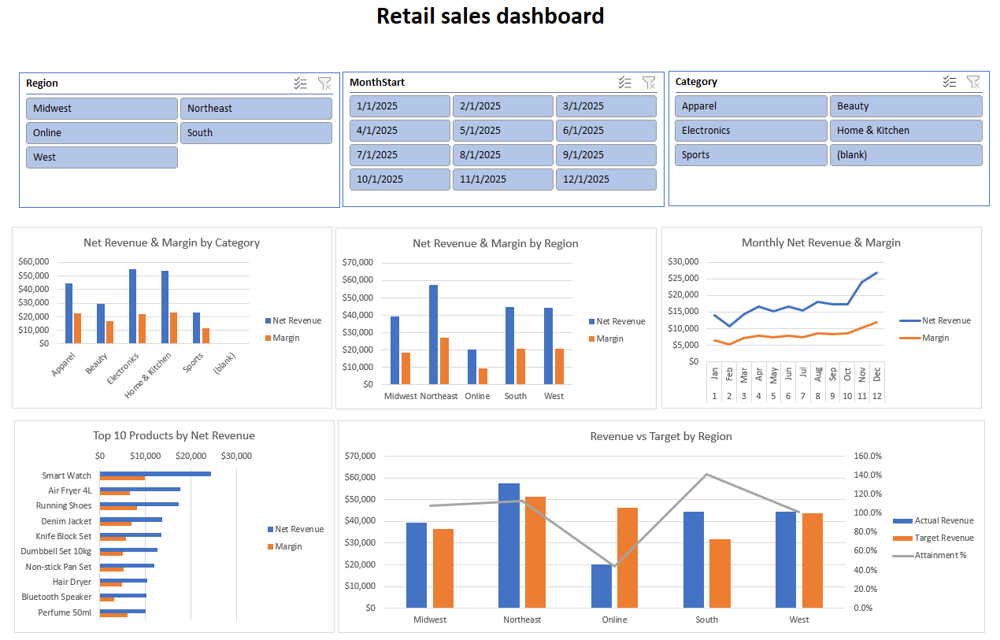

# Retail Sales Dashboard (Excel)

An Excel project that turns 12 messy monthly sales files into a clean dashboard, using Power Query, the Data Model, DAX and PivotTables.

The data is synthetic. It was generated for practice, with realistic problems added on purpose. No real company or customer is behind it.

## Data problems fixed

- A junk title line above the header in every file: removed it and used the next row as the header
- July had different column names (Qty and Discount): loaded it separately, renamed the columns and appended it
- Dates in 3 different formats: converted them with two settings and combined the results
- Store codes with extra spaces and mixed case: trimmed and set to uppercase
- Prices like $59.99 and discounts like 10% or blank: removed the symbols and set blanks to 0
- Duplicate order lines: removed
- Blank customer IDs: labeled GUEST
- A product ID missing from the product table: kept in revenue, shown as blank in the category chart
- Negative quantities: kept as returns

## What I built

- One clean sales table of 2,865 rows
- A data model linking sales to products, stores, customers, dates and targets (8 relationships)
- Three measures: Actual Revenue, Target Revenue and Attainment %
- Five charts with slicers for region, month and category

## Key findings

- Net revenue of about $206K against a $210K target (98.4%)
- Online reached only about 44% of its target, while the South reached about 141%
- The top 10 products make up about 69% of revenue
- Electronics earns the most revenue but has a lower margin (about 40%) than Beauty (about 57%)

## Files

- Retail_Project.xlsx: the finished workbook
- sales_csv_folder: the 12 raw monthly files
- retail_dimention_tables: products, customers, stores and targets
- Retail_Sales_Dashboard.png: screenshot of the dashboard

## Note

The data is stored inside the workbook, so the dashboard and slicers work as soon as you open it. Refresh All reads from the original folder paths, so to refresh, point the queries at your own copy of the files under Data, Get Data, Data Source Settings.

Tools: Excel, Power Query, Data Model, DAX, PivotTables
